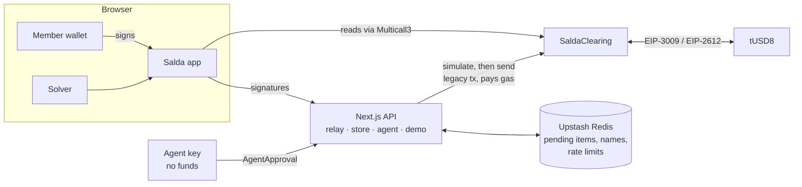
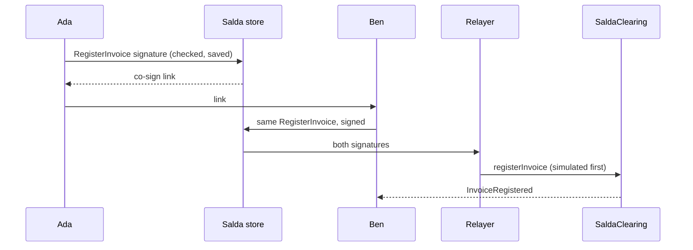
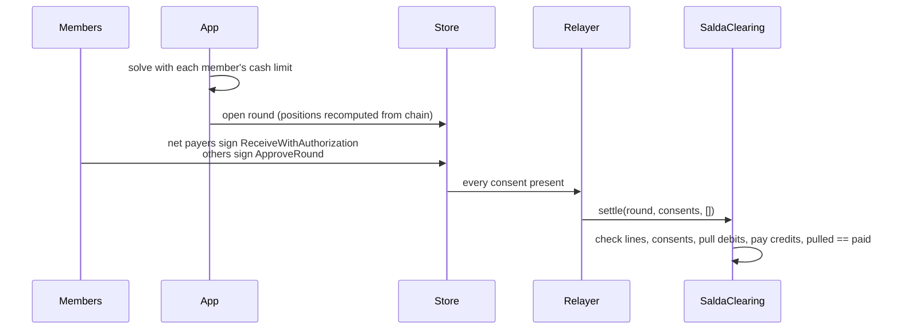
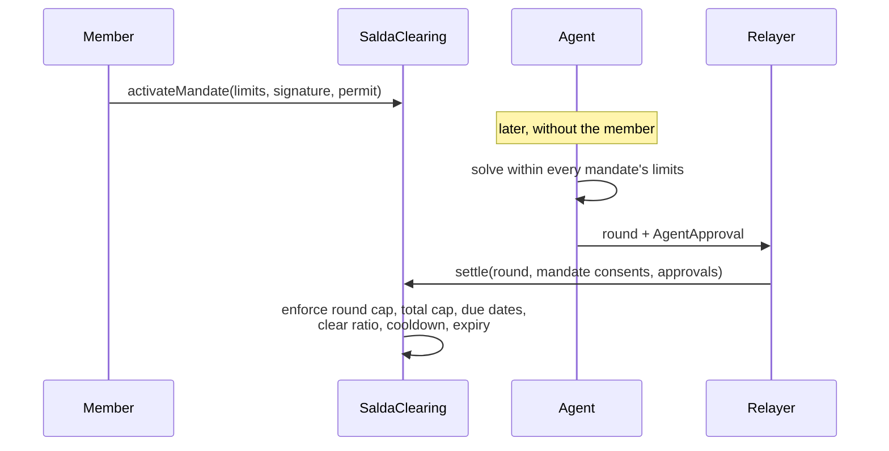
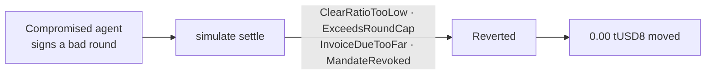

<p align="center">
  
</p>

<p align="center">
  <a href="LICENSE"></a>
  
  
  
</p>

> **Three shops owe each other 15.00. Salda settles all of it with 2.00. With no cash at all, it still clears 12.00.**
>
> Salda cancels what a group of businesses owe each other and settles only the difference, in one all-or-nothing step, in `tUSD8` on the QDay Aevum testnet. An entry in Aevum Builder Challenge #1 (Invoice Payments track).

**Live:** [salda-nu.vercel.app](https://salda-nu.vercel.app) · **Demo:** [/demo](https://salda-nu.vercel.app/demo) · **Docs:** [/docs](https://salda-nu.vercel.app/docs)

## Contents

- [The problem](#the-problem)
- [Features](#features)
- [Quick start](#quick-start)
- [How it works](#how-it-works)
- [Installation](#installation)
- [Usage](#usage)
- [API reference](#api-reference)
- [Configuration](#configuration)
- [Deployment](#deployment)
- [Testing](#testing)
- [How each technology is used](#how-each-technology-is-used)
- [Known constraints](#known-constraints)
- [Troubleshooting](#troubleshooting)
- [Roadmap, prior art and business model](#roadmap-prior-art-and-business-model)
- [Development](#development)
- [License](#license)

## The problem

Small businesses that trade with each other wait on each other to pay. Ada’s Bakery can’t pay Ben’s Farm until Chidi Transport pays her; Chidi is waiting on Ben; Ben is waiting on Ada. Everyone has debts and nobody has the cash to go first.

Salda looks at every open invoice in the group, finds the debts that cancel out, and moves only what is left. Every business signs first, a smart contract rechecks the whole round, and either all of it settles or none of it does. Salda never holds anyone’s money: payments go straight from the businesses that owe to the businesses that are owed.

**Who it is for:** groups that already trade in circles, such as cooperatives, market associations, wholesaler networks, and subsidiaries of one company.

| Ada’s cash | Debt cleared (of 15.00) | Ada pays | Ben receives | Chidi receives |
|---|---|---|---|---|
| 0.00 | 12.00 | 0.00 | 0.00 | 0.00 |
| 1.00 | 14.00 | 1.00 | 0.00 | 1.00 |
| 2.00 | 15.00 | 2.00 | 1.00 | 1.00 |

## Features

- ✅ **Co-signed invoices.** An invoice counts only when both businesses sign; up to 30 at once with one signature each.
- ✅ **Cash-limited clearing solver.** Exact `BigInt` min-cost circulation that clears the most debt each business can afford, in the browser.
- ✅ **All-or-nothing settlement.** One transaction; the contract rechecks every line and every consent, and never keeps any money.
- ✅ **Gasless for members.** Members only sign; a relayer submits and pays the fee, and anyone can submit the same signatures instead.
- ✅ **Standing mandates.** Sign once with limits (per round, total, due date, minimum clear ratio, cooldown, expiry); revoke instantly, with no gas.
- ✅ **Untrusted clearing agent.** Plans and settles rounds within mandates, with plain-language explanations. A compromised agent is refused by the contract.
- ✅ **Private names.** Business names, circle names and invoice documents go onchain only as salted hashes.
- 🚧 **Live on Aevum.** Contract written and compiled; deployment, the explorer proofs and the test runs are in progress (see [Deployment](#deployment)).

## Quick start

No wallet needed:

```bash
git clone https://github.com/Dominion116/Salda.git
cd Salda/web
npm install
npm run dev
```

Open <http://localhost:3000>. Without a deployed contract configured, the app and demo run on clearly labelled sample data.

## How it works

### System architecture



### Invoice co-signing



### Manual round



### Mandate round



### Rejected round



## Installation

### Prerequisites

| Tool | Version | Used for |
|---|---|---|
| Node.js | 24 (22.18+ works) | The web app and its tests (they import TypeScript directly) |
| npm | 10+ | Packages |
| Foundry | 1.x | Contracts: `forge`, `cast` |
| Git | any | Submodules for `forge-std` and OpenZeppelin |

### Steps

```bash
git clone https://github.com/Dominion116/Salda.git
cd Salda
git submodule update --init   # forge-std v1.17.0, OpenZeppelin v5.1.0 (no --recursive needed)

cd contracts
forge build
node ../tools/check-shanghai.mjs out   # Aevum runs Shanghai: no Cancun opcodes

cd ../web
npm install
cp .env.example .env.local
npm run dev
```

## Usage

### In the browser

1. **Landing page:** move Ada’s cash on the clearing graph. No wallet needed.
2. **[/demo](https://salda-nu.vercel.app/demo):** connect a wallet on Aevum, sign twice, and settle a real round at 1/100 scale (0.15 cleared with 0.02). Salda seeds the 0.02 and pays every fee. Then try the simulated compromised agent.
3. **[/app](https://salda-nu.vercel.app/app):** create a circle, add members, co-sign invoices, plan and settle rounds, set up a mandate, and run the agent.

### Build and sign a round in TypeScript

The helpers in [`web/src/chain/salda.ts`](web/src/chain/salda.ts) hold every type and hash the contract checks.

```typescript
import { createWalletClient, http } from "viem";
import { privateKeyToAccount } from "viem/accounts";
import {
  aevum, CONSENT_SIGNED, hashRound, settleNonce, tusd8Domain, tusd8Types, type RoundInput,
} from "./web/src/chain/salda";
import { toWire } from "./web/src/lib/wire";

const salda = "0xYourSaldaClearingAddress";
const ada = privateKeyToAccount(process.env.TEST_ONLY_KEY as `0x${string}`);
const wallet = createWalletClient({ account: ada, chain: aevum, transport: http() });

// The 1/100-scale three-shop round: invoice ids strictly ascending, amounts in 6-decimal units.
const round: RoundInput = {
  circleId: 1n,
  roundNonce: 1n,
  deadline: BigInt(Math.floor(Date.now() / 1000) + 3600),
  invoiceIds: [1n, 2n, 3n],
  clearAmounts: [60_000n, 50_000n, 40_000n], // 0.06 + 0.05 + 0.04 = 0.15 cleared
};
const roundHash = hashRound(salda, round);

// Ada clears 0.06 she owes and 0.04 owed to her, so she pays 0.02 net:
// she signs a tUSD8 authorization for exactly that, bound to this round.
const signature = await wallet.signTypedData({
  domain: tusd8Domain,
  types: tusd8Types.ReceiveWithAuthorization,
  primaryType: "ReceiveWithAuthorization",
  message: {
    from: ada.address,
    to: salda,
    value: 20_000n,
    validAfter: 0n,
    validBefore: round.deadline,
    nonce: settleNonce(salda, roundHash, ada.address),
  },
});

await fetch("https://salda-nu.vercel.app/api/store", {
  method: "POST",
  headers: { "content-type": "application/json" },
  body: toWire({
    action: "round.consent",
    circleId: round.circleId,
    key: roundHash,
    consent: { member: ada.address, kind: CONSENT_SIGNED, validAfter: 0n, validBefore: round.deadline, signature },
  }),
});
```

The round must first be opened with `{"action": "round.open", "round": …}`. Members who receive or move no cash sign `ApproveRound(roundHash, member, outTotal, inTotal)` in the Salda domain instead.

## API reference

All bodies are JSON. Every whole-number amount travels as `{"$bigint": "123"}`. Errors return `{"error": "…"}` with a plain sentence and a 4xx or 5xx status.

### `POST /api/relay`

Submits one allowlisted `SaldaClearing` call and pays its fee. It simulates first, so a failing call costs nothing.

| Field | Type | Description |
|---|---|---|
| `functionName` | `string` | One of `settle`, `registerInvoice`, `registerInvoices`, `voidInvoice`, `payDirectWithAuthorization`, `createCircleWithSig`, `setCircleMemberWithSig`, `activateMandate`, `revokeMandateWithSig`, `bumpMandateEpochWithSig` |
| `args` | `array` | The function’s arguments, already signed |

```json
// request
{ "functionName": "revokeMandateWithSig", "args": ["0x5c1d…", { "$bigint": "1795729000" }, "0x8f2a…"] }
// response
{ "hash": "0x3b7e…" }
```

`GET /api/relay` returns `{ "enabled": true, "relayer": "0x…", "contract": "0x…" }`.

### `/api/store`

Holds items waiting for another person. Every signature is verified before it is saved; the contract verifies it again.

| Request | Returns or does |
|---|---|
| `GET ?kind=pending&circleId=1` | Invoices signed by one business |
| `GET ?kind=voids&circleId=1` | Void requests waiting for the other business |
| `GET ?kind=rounds&circleId=1` | Rounds, newest first |
| `GET ?kind=round&circleId=1&key=0x…` | One round, with its state (`waiting-for-signatures`, `submitting`, `pending`, `confirmed`, `failed`) |
| `GET ?kind=cash&circleId=1` | Signed cash limits |
| `POST {"action": "invoice.propose" \| "invoice.cosign" \| "void.sign" \| "round.open" \| "round.consent" \| "round.settle" \| "cash.set" \| "names.set" \| "names.get", …}` | The write named |

```json
// POST {"action": "round.settle", "circleId": {"$bigint": "1"}, "key": "0x9a41…"}
{ "key": "0x9a41…", "state": "pending", "txHash": "0x77c2…", "gross": { "$bigint": "150000" }, "cash": { "$bigint": "20000" } }
```

### `/api/agent`

| Request | Returns or does |
|---|---|
| `GET ?info=1` | `{ "agent": "0x…", "agentId": {"$bigint": "0"} }` |
| `GET ?circleId=1` | Recent activity: `[{ "kind": "settled", "summary": "Round settled: 15.00 cleared with 2.00 tUSD8. …" }]` |
| `POST {"circleId": {"$bigint": "1"}}` | Runs clearing now |
| `GET ?cron=1` with `Authorization: Bearer $CRON_SECRET` | The daily scheduled run ([`web/vercel.json`](web/vercel.json)) |

### `/api/demo`

`POST` with `action`: `start` (`player`), `register` (`circleId`, `signature`), `settle` (`circleId`, `round`, `consent`), or `attack` (`attack`: `fair` \| `ratio` \| `cap` \| `due`, `revoked`). The attack response is `{ "refused": true, "revert": "ClearRatioTooLow", "message": "…", "moved": "0.00" }`.

### Rate limits

| Route | Limit |
|---|---|
| Relay | 10/min per IP; `RELAYER_DAILY_TX_LIMIT` per day |
| Store | 120 reads and 30 writes per min per IP |
| Agent | 60 reads and 5 runs per min per IP |
| Demo | 20/min per IP; 5 sessions/day per wallet, 10 per IP; 2 seeds/day per wallet, 4 per IP; `DEMO_DAILY_LIMIT` seeds/day overall |

## Configuration

### Web (`web/.env.local` and Vercel)

Template: [`web/.env.example`](web/.env.example). Use fresh **test-only** wallets for every key.

| Variable | Purpose | Example | Required | Secret |
|---|---|---|---|---|
| `NEXT_PUBLIC_SALDA_ADDRESS` | Deployed SaldaClearing; without it the app uses sample data | `0x5A1d…` | For live data | No |
| `NEXT_PUBLIC_WC_PROJECT_ID` | WalletConnect for phone wallets ([cloud.reown.com](https://cloud.reown.com)) | `3f9c…` | No | No |
| `RELAYER_PRIVATE_KEY` | Pays relayed gas; holds demo tUSD8 | `0x…` (64 hex) | For live data | **Yes** |
| `AGENT_PRIVATE_KEY` | Agent approval key; no funds | `0x…` (64 hex) | For mandates | **Yes** |
| `AGENT_ID` | ERC-8004 agent ID | `0` | No | No |
| `AGENT_CIRCLES` | Circles for the daily run | `1,4` | No | No |
| `CRON_SECRET` | Authenticates Vercel Cron | random string | For scheduling | **Yes** |
| `DEMO_BEN_KEY`, `DEMO_CHIDI_KEY` | Server-held demo counterparties | `0x…` (64 hex) | For live demo | **Yes** |
| `DEMO_ATTACK_CIRCLE` | Compromised-agent circle (from `DemoSetup.s.sol`) | `2` | For live attacks | No |
| `DEMO_ATTACK_INVOICES` | Its three invoice ids | `4,5,6` | For live attacks | No |
| `DEMO_DAILY_LIMIT` | Seeds per day, everyone | `100` | No | No |
| `UPSTASH_REDIS_REST_URL` | Shared store | `https://….upstash.io` | On Vercel | No |
| `UPSTASH_REDIS_REST_TOKEN` | Shared store token | `AX…` | On Vercel | **Yes** |
| `TRUSTED_IP_HEADER` | Real client IP header | `x-vercel-forwarded-for` | On Vercel | No |
| `RELAYER_DAILY_TX_LIMIT` | Relayed tx per day | `500` | No | No |

### Contracts (`contracts/.env`)

Template: [`contracts/.env.example`](contracts/.env.example). `PRIVATE_KEY` (deployer, **secret**); optional `SALDA_ADDRESS`, `AGENT_REGISTRY` (ERC-8004 registry, unset = off); for `DemoSetup.s.sol`: `RELAYER_PRIVATE_KEY`, `DEMO_BEN_KEY`, `DEMO_CHIDI_KEY`, `AGENT_ADDRESS`.

## Deployment

```bash
cd contracts
forge script script/Deploy.s.sol    --rpc-url aevum --legacy --broadcast   # prints NEXT_PUBLIC_SALDA_ADDRESS
forge script script/DemoSetup.s.sol --rpc-url aevum --legacy --broadcast   # prints DEMO_ATTACK_*
forge script script/MaxRound.s.sol  --rpc-url aevum --legacy --broadcast   # the 10-member, 30-invoice proof
node ../tools/export-abi.mjs out ../web/src/chain/abi.ts
```

Then set the web variables in Vercel (root directory `web`, framework preset Next.js) and deploy.

### Aevum testnet addresses

The Aevum explorer cannot verify contract source, so the exact deployment is published here instead.

| Item | Value |
|---|---|
| `SaldaClearing` | _Published after deployment_ |
| Constructor | `token = 0x456569838f1d43009A91ebA4263147Afd7233483` (tUSD8), `agentRegistry = 0x0000000000000000000000000000000000000000` (off until the registry is confirmed) |
| Source commit | _Published after deployment_ |
| ABI | [`web/src/chain/abi.ts`](web/src/chain/abi.ts), generated from `contracts/out` |

### Explorer proofs

| Proof | Transaction |
|---|---|
| Full-scale round: 15.00 cleared with 2.00 | _Pending_ |
| Rejected agent-signed round (limit violated) | _Pending_ |
| Revoke, then the next settlement rejected | _Pending_ |
| Maximum-size round: 10 members, 30 invoices | _Pending_ |

## Testing

```bash
# contracts/
forge test                                                 # unit, fuzz and mandate tests
forge test --match-path 'test/fork/*' --fork-url aevum     # against real tUSD8 on a fork
node ../tools/check-shanghai.mjs out

# web/
npm run check   # type check, design-token rules, unit tests (incl. solver vs brute force)
npm run build
```

| Suite | Covers |
|---|---|
| `contracts/test/SaldaClearing.t.sol` | The 15→2 and 12→0 rounds, replay, expiry, missing and wrong consents, bad lines, blacklist, ERC-1271 wallets, 10×30 round, cash-conservation fuzzing, invoices, voids, direct payment, circles |
| `contracts/test/Mandates.t.sol` | One live mandate, stale and revoked activations, front-run permit, agent approval, every limit at its boundary, gasless revoke, registry outage |
| `contracts/test/fork/AevumFork.t.sol` | tUSD8 domain, sandbox round and max-size round with real tUSD8 |
| `web/tests/solver.test.mjs` | 15/14/12, `[3, 2]` ratio case, brute-force optimum on random graphs, iteration guard, N=10/E=30 benchmark |

## How each technology is used

| Technology | How Salda uses it |
|---|---|
| `tUSD8` **EIP-3009** | Net payers sign `ReceiveWithAuthorization` for exactly their net debit, with a nonce bound to the round hash; also direct invoice payments |
| `tUSD8` **EIP-2612** | A mandate’s permit sets Salda’s allowance to its total cap; applied in `try/catch` so a front-run permit cannot block activation |
| **EIP-712** | Every Salda signature: invoices, batches, voids, round approvals, mandates, agent approvals, revokes |
| **Multicall3** | Batched reads of circle membership |
| **Scoped agent key** | Holds nothing; its `AgentApproval` is required for mandate consent, and only within each mandate’s limits |
| **ERC-8004** | Optional: with a registry set, activation requires the agent key to own `agentId`. `settle()` never calls it |
| **Shanghai EVM** | Solidity 0.8.24, `evm_version = "shanghai"`, checked by `tools/check-shanghai.mjs` |

## Known constraints

- Wallet addresses, who owes whom, and amounts are **public** onchain. Names and documents are salted hashes only.
- The explorer cannot verify source code; compare the published commit with the deployed address.
- Gasless use needs the relayer to be up. It is untrusted: anyone with tQDAY can submit the same signatures.
- Names are only as trustworthy as the circle admin who confirms them.
- With mandate ratios, the solver uses a heuristic tightening step. It is always feasible but not always optimal; the contract enforces every limit regardless.
- Rounds are all or nothing; one silent or blacklisted member stops a round.
- Test tokens only. The contract is not audited.

## Troubleshooting

**The app shows “Sample data” with my wallet connected.** Switch the wallet to Aevum testnet (chain 44005), and check that `NEXT_PUBLIC_SALDA_ADDRESS` is set for the deployment.

**“Your wallet already has a network using the same address.”** MetaMask refuses a second network with the same RPC URL. Edit or remove the existing Aevum entry, then connect again.

**`forge build` cannot find `forge-std` or OpenZeppelin.** Run `git submodule update --init` from the repo root.

**A round stays “Still confirming”.** It was sent; the page checks again every few seconds. Open the explorer link to watch it.

**Everything resets on Vercel.** Set `UPSTASH_REDIS_REST_URL` and `UPSTASH_REDIS_REST_TOKEN`; without them the server keeps state in memory only.

## Roadmap, prior art and business model

**Roadmap:** pilot circles on testnet → independent security audit → legal review of multilateral set-off per country → amount privacy → mainnet through the QDay builder program with a mainnet stablecoin. Not planned: liquidity pools, tokenized invoices, protocol fees inside the contract.

**Prior art:** clearing debt in cycles is centuries old. Salda builds on the [Cycles Protocol](https://arxiv.org/abs/2507.22309) paper (Informal Systems), academic work on clearing invoice graphs, mutual-credit networks such as Sardex, WIR Bank and Sarafu, and Renaissance clearing fairs in Lyon and Bisenzone. Salda’s difference: non-custodial atomic settlement in a real stablecoin, with no escrow or IOUs, and contract-enforced standing mandates with a minimum clear ratio.

**Business model (hypotheses to test, not results):** circle operators pay, members use it free. Free for small circles; a flat monthly subscription for larger ones with scheduled rounds, statements and exports. Fees stay outside the contract, so what is pulled always equals what is paid.

## Development

```bash
cd web
npm run dev          # app at localhost:3000
npm run typecheck
npm run check:tokens # design-token and motion rules
npm test
```

Contributions are welcome:

1. Fork the repository
2. Create a branch (`git checkout -b feat/your-change`)
3. Commit (`git commit -m "feat: describe your change"`)
4. Push and open a pull request

Please run `forge test` and `npm run check` first.

## License

MIT. See [LICENSE](LICENSE). Third-party code and dependencies are listed in [NOTICE.md](NOTICE.md).

## Acknowledgments

- [qday-io/aevum-starter-kit](https://github.com/qday-io/aevum-starter-kit) (MIT, PQA Labs): Foundry setup, `MockUSD8`, fork tests, the Shanghai check and relayer rails
- [OpenZeppelin Contracts](https://github.com/OpenZeppelin/openzeppelin-contracts) and [forge-std](https://github.com/foundry-rs/forge-std)
- [RainbowKit](https://www.rainbowkit.com), [wagmi](https://wagmi.sh) and [viem](https://viem.sh)
- QDay, for the Aevum testnet and the Builder Challenge
